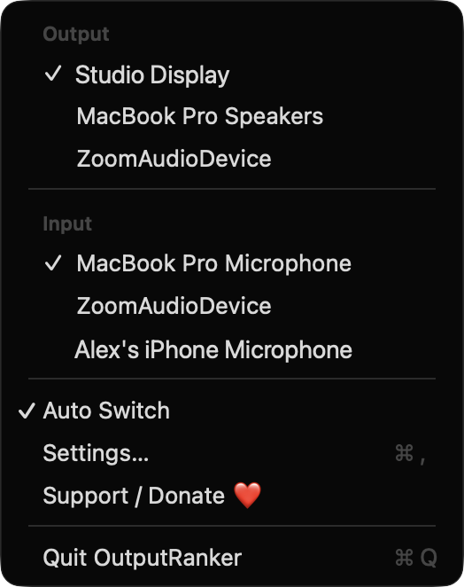
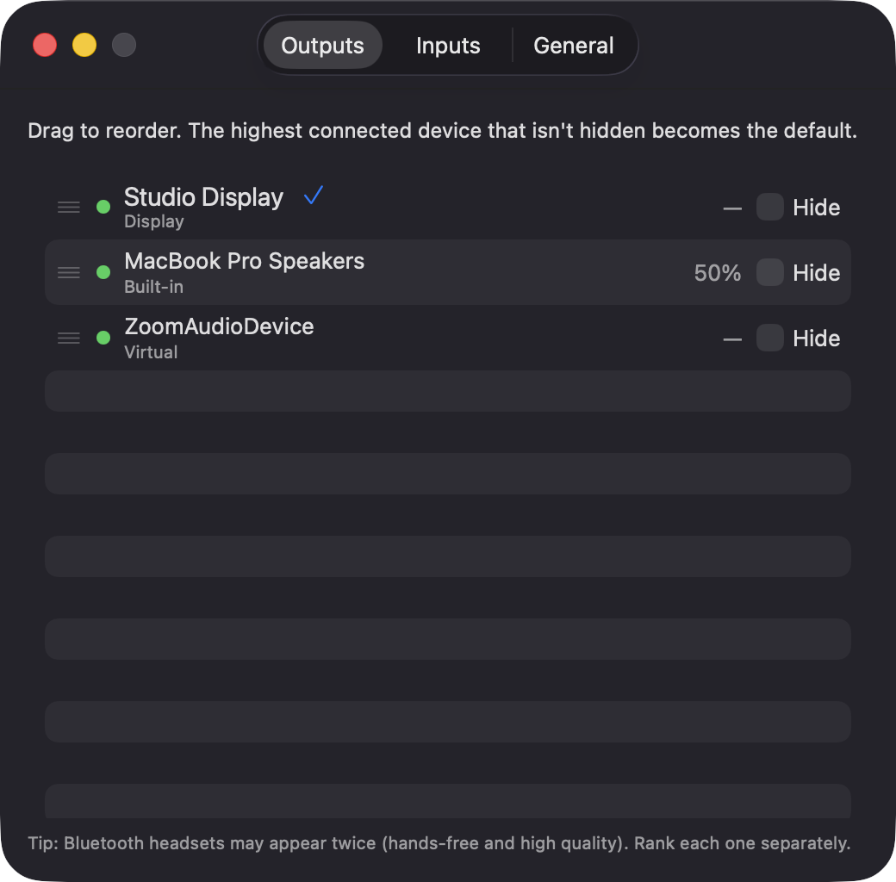
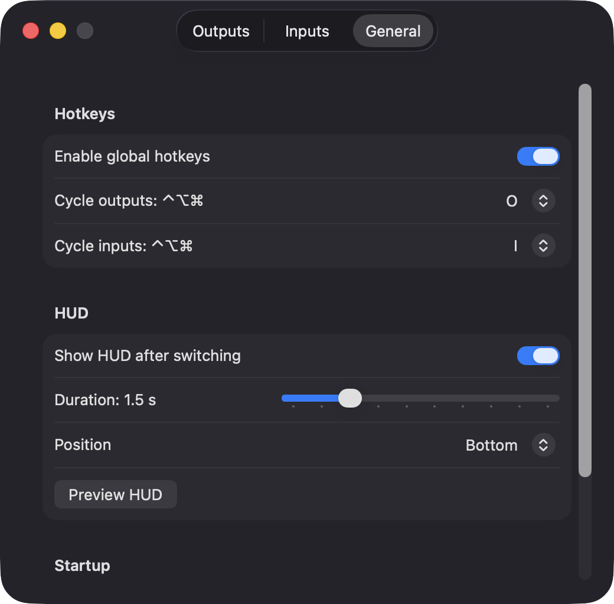

# OutputRanker

**🌐 Website:** [turhe123.github.io/output-ranker](https://turhe123.github.io/output-ranker/)

Rank your audio inputs and outputs so the Mac always picks your best connected device, with a volume HUD.

> 🆓 A free, open-source **BetterAudio alternative** for macOS 14+. Native Swift, no accounts, no subscriptions, MIT licensed.


## Why

OutputRanker is a free, open-source, 100% native, backend-free alternative to paid utilities in the *Audio* category. It was inspired by BetterAudio ($10 one-time), a menu bar audio switcher with device priorities. OutputRanker focuses on one job: device priority and quick switching. It has no per-app volume and no audio taps. There is no server, no account, and no analytics.

## Features

- **Two ranked lists**, one for outputs and one for inputs. Reorder them by dragging in Settings.
- **Automatic switching.** When devices appear or disappear, the highest-ranked connected device becomes the system default. Input, output and system output are all updated. Events are debounced by about 300 ms because devices often show up in bursts.
- **Fallback.** If a device fails to become the default, the next one in the list is tried.
- **Manual override.** Picking a device from the menu (or changing it in System Settings) holds until the device list next changes. Inputs and outputs have separate overrides.
- **Auto Switch toggle.** Turn it off and the app only switches when you ask it to.
- **Menu bar menu** showing connected devices per scope, a checkmark on the current one, and one-click switching.
- **Remembered volume per device**, restored when you switch to that device. The Settings list shows it.
- **Hide flag** to exclude a device (for example a virtual driver) from automatic switching and cycling.
- **Device info.** Each row shows a connected dot and the transport (Built-in, Bluetooth, USB, Virtual). Disconnected devices stay in place, greyed out, so their rank is preserved. Right-click one to forget it.
- **New devices** are added to the bottom of the list the first time they are seen.
- **Bluetooth headsets** that expose two profiles (hands-free and high quality) can be ranked separately. The UI mentions this.
- **On-screen HUD**: a borderless, rounded, click-through panel showing the device name and its volume after a switch. You can choose its duration (0.5–5 s) and position (top, center, bottom), and preview it.
- **Global hotkeys** to cycle outputs and inputs. They use ⌃⌥⌘ plus a letter you choose (default O for outputs and I for inputs).
- **Launch at login** via `SMAppService`.
- **Menu-bar-only app** with no Dock icon.

## Screenshots

<p align="center"></p>

<p align="center"><em>The menu bar menu lists connected outputs and inputs, checks the current one, and switches devices in one click.</em></p>

<p align="center"></p>

<p align="center"><em>In Settings you drag devices into priority order, and each row shows its connection status, transport, remembered volume and a Hide option.</em></p>

<p align="center"></p>

<p align="center"><em>The General tab sets the global hotkeys for cycling devices and the duration and position of the on-screen volume HUD.</em></p>

## Install

1. Download `OutputRanker-macOS.zip` from the [latest release](https://github.com/turhe123/output-ranker/releases/latest).
2. Unzip it and move `OutputRanker.app` to `/Applications`.
3. The app is open source and not notarized, so remove the quarantine attribute:

   ```bash
   xattr -cr /Applications/OutputRanker.app
   ```

4. The first time, right-click the app and choose **Open**.

Requires macOS 14.0 or later.

## Build from source

You need Xcode and [XcodeGen](https://github.com/yonaskolb/XcodeGen).

```bash
brew install xcodegen
xcodegen generate
xcodebuild -project OutputRanker.xcodeproj -scheme OutputRanker -configuration Release -derivedDataPath ./build build
```

The app is written to `build/Build/Products/Release/OutputRanker.app`.

## Permissions

OutputRanker does not request any privacy permission. Based on the code:

- **Accessibility:** not needed. Hotkeys use Carbon `RegisterEventHotKey`, which does not require it.
- **Screen Recording:** not needed. The HUD is only a window that the app draws itself.
- **Microphone:** not needed. The app lists and switches input devices and reads their volume property, but never captures audio.
- **Login Items:** only if you enable "Launch at login". macOS may show it in System Settings › General › Login Items.

Everything is stored locally in `UserDefaults`: ranks as arrays of device UIDs, hidden devices, device names and per-device volumes.

## Built with AI

OutputRanker was written by [Claude Code](https://claude.com/claude-code) inside an automated pipeline, from a plain-English spec. No code, binaries or assets from any commercial app were used; it is a clean-room reimplementation of a feature set, not a copy.

What that means in practice:

- The full source is in this repo under the MIT license. Read it before you run it.
- No network calls, no analytics, no third-party dependencies. Only Apple frameworks.
- Ad-hoc signed and not notarized, which is why Gatekeeper warns on first launch.
- It has had less human review than a hand-written app. Bug reports and pull requests are welcome.

## Support ❤️

OutputRanker is free and always will be. If it's useful to you, you can support its development:

[Support Or (Leo) Davidai ❤️](https://ko-fi.com/leodavidai)

The app also has a "Support / Donate ❤️" button in its menu and in Settings.

## More free Mac apps

OutputRanker is one of [60 free, open-source Mac utilities](https://github.com/turhe123/mac-apps) built the same way: native Swift, no accounts, no telemetry. Browse the full gallery at [turhe123.github.io/mac-apps](https://turhe123.github.io/mac-apps/).

## License

MIT © Or Davidai Bachar
